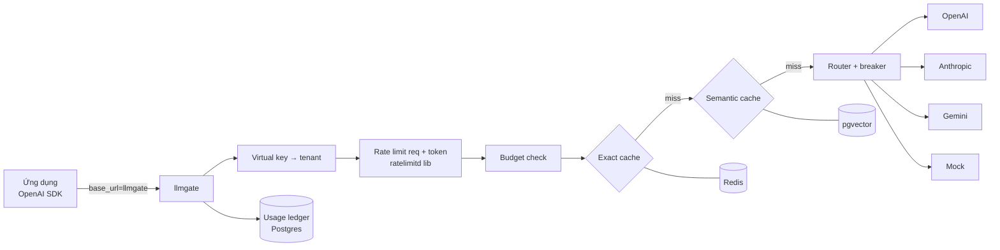

# llmgate — AI Gateway tiết kiệm chi phí (Go + Redis + PostgreSQL/pgvector)

> Bài #5: *"Hai câu hỏi có cùng ý nghĩa liệu có cần gọi AI hai lần? Nếu giảm được số lần gọi model mà vẫn đảm bảo chất lượng câu trả lời, bạn đang trực tiếp tiết kiệm tiền cho doanh nghiệp."*
> Kết hợp ý tưởng #8 (truy vết request → LLM) và #14 (chi phí theo từng request/khách hàng).

`llmgate` là một lớp trung gian **tương thích OpenAI API** đứng giữa ứng dụng và các nhà cung cấp LLM. Ứng dụng chỉ cần đổi `base_url` và dùng một virtual key; gateway lo phần còn lại: định tuyến, failover, cache chính xác và cache ngữ nghĩa, giới hạn token/phút, ngân sách USD theo tenant, và ghi chi phí của **từng request**.

## Tính năng (v1.0)

- API tương thích OpenAI: `POST /v1/chat/completions` (cả stream SSE), `POST /v1/embeddings`, `GET /v1/models`.
- Adapter: **OpenAI, Anthropic, Google Gemini, Mock** (mock cấu hình được độ trễ, lỗi, token — mặc định để test không tốn tiền).
- **Model alias và routing:** `fast`, `smart`, `cheap` → danh sách model ưu tiên/trọng số; fallback khi 429/5xx/timeout; circuit breaker theo provider; timeout tới token đầu tiên (TTFT).
- **Cache 2 tầng:** exact cache (Redis, băm request đã chuẩn hoá) và semantic cache (pgvector, cosine ≥ ngưỡng, cô lập theo tenant, chỉ khi an toàn).
- **Kiểm soát chi phí:** virtual key → tenant; rate limit request/phút và **token/phút** (dùng lại thư viện `ratelimitd`); ngân sách USD theo ngày/tháng, soft limit (cảnh báo) và hard limit (chặn); bảng giá cấu hình được.
- **Đo lường:** usage ledger mỗi request (token vào/ra, cache hit, provider, model, latency, chi phí USD); OpenTelemetry trace theo chuẩn GenAI semantic conventions; dashboard chi phí theo tenant/model/endpoint.
- **An toàn:** key provider mã hoá at-rest (AES-GCM), log đã loại PII, không bao giờ cache chéo tenant.

## Mục tiêu đo lường

| Chỉ số | Mục tiêu |
|---|---|
| Overhead gateway p99 (không cache, mock provider 0 ms) | < 5 ms |
| Latency khi exact cache hit p99 | < 10 ms |
| Latency khi semantic cache hit p99 | < 40 ms (gồm tạo embedding) |
| Semantic cache precision tại ngưỡng đã chọn | ≥ 97 % trên tập paraphrase có nhãn |
| Giảm chi phí trên workload phát lại (FAQ hỗ trợ khách hàng) | báo cáo X % (mục tiêu ≥ 30 %) |
| Tỷ lệ thành công khi provider chính sập 100 % | ≥ 99,5 % (nhờ fallback) |
| Sai lệch đếm token streaming so với usage của provider | 0 (dùng usage trả về), ước lượng ±3 % khi thiếu |

## Kiến trúc tóm tắt

## Tài liệu

| File | Nội dung |
|---|---|
| [docs/PLAN.md](docs/PLAN.md) | Kế hoạch 4 tuần |
| [docs/SPEC.md](docs/SPEC.md) | Yêu cầu, routing, cache, budget, cấu hình, mô hình dữ liệu |
| [api/openapi.yaml](api/openapi.yaml) | Proxy API + Admin API |
| [docs/ARCHITECTURE.md](docs/ARCHITECTURE.md) | Pipeline middleware, streaming, failover |
| [docs/TESTING.md](docs/TESTING.md) | Eval semantic cache, chaos provider, load |
| [docs/BENCHMARK.md](docs/BENCHMARK.md) | Mẫu kết quả |
| [docs/adr/](docs/adr/) | Quyết định kiến trúc |
