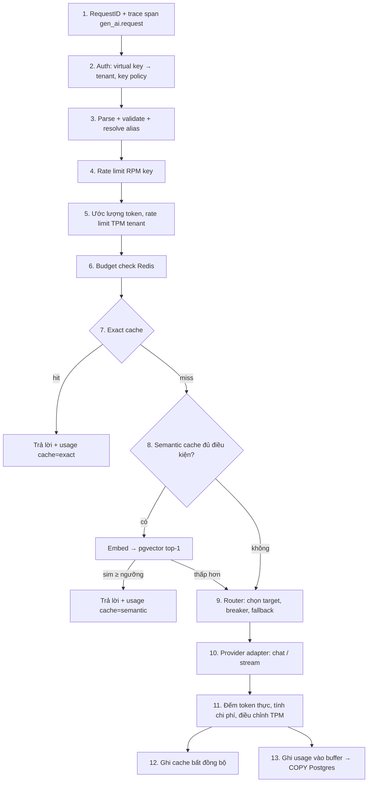
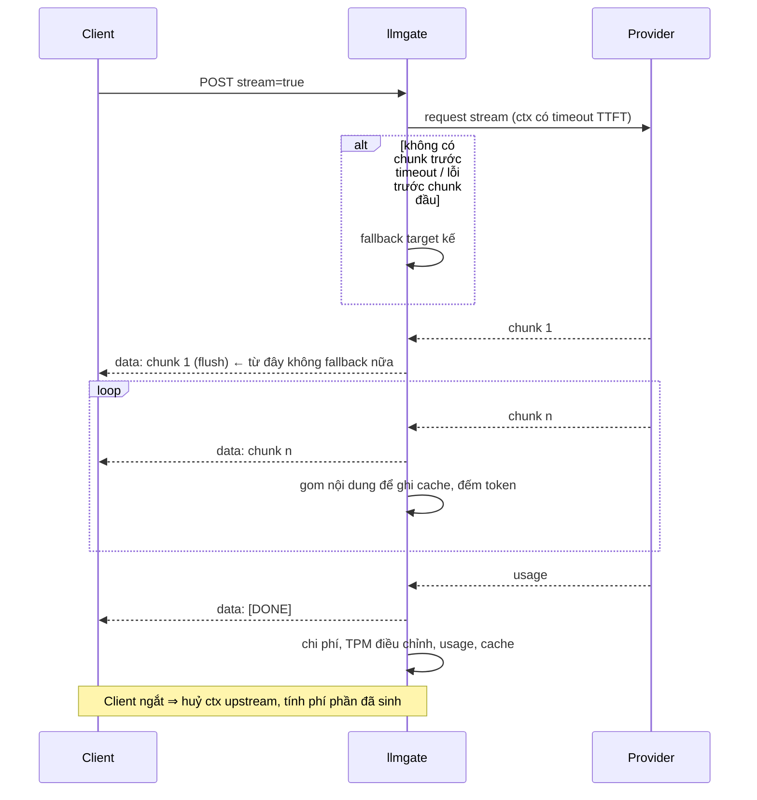
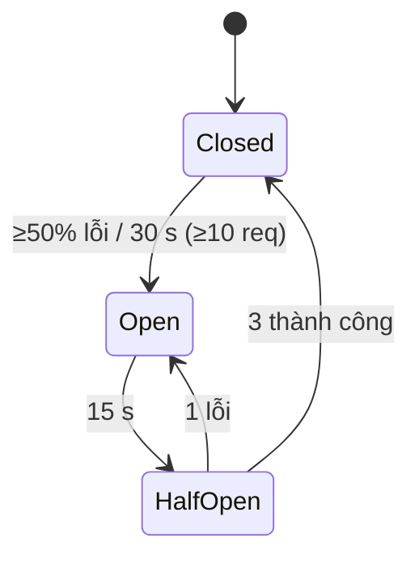

# ARCHITECTURE — llmgate

## 1. Pipeline xử lý một request

Mỗi bước là một middleware có thể tắt/bật, theo thứ tự:



| Package | Trách nhiệm |
|---|---|
| `internal/openai` | Kiểu dữ liệu OpenAI, encode/decode SSE |
| `internal/provider/{openai,anthropic,gemini,mock}` | Adapter, map lỗi về `ProviderError{Status, Retryable, RetryAfter}` |
| `internal/router` | Alias, chiến lược, breaker, health score |
| `internal/cache/exact`, `internal/cache/semantic` | |
| `internal/limits` | Bọc `ratelimitd/pkg/limiter` cho RPM/TPM |
| `internal/budget` | Bộ đếm Redis + đối chiếu Postgres |
| `internal/usage` | Buffer, batch COPY, tính chi phí |
| `internal/pricing` | Tra giá theo model + thời điểm |
| `internal/crypto` | AES-GCM cho credential |
| `internal/admin` | Admin API |

## 2. Streaming



- Mỗi stream một goroutine đọc upstream, ghi `http.Flusher`; backpressure tự nhiên qua TCP (không buffer vô hạn).
- Bộ đệm gom nội dung để cache giới hạn 64 KB; vượt thì không cache.

## 3. Rate limit token (TPM) hai pha

```
pha 1: hits = prompt_tokens_estimate + max_tokens (hoặc mặc định 1024)
       token bucket TPM ⇒ từ chối ngay nếu không đủ
pha 2: actual = input + output
       nếu actual < hits: hoàn lại (hits - actual) vào bucket
       nếu actual > hits: trừ thêm (có thể âm tạm thời — chấp nhận)
```

Lý do chọn token bucket thay vì GCRA cho TPM: cần hoàn lại token (ADR-0003).

## 4. Failover và breaker



Router bỏ qua target có breaker mở; nếu mọi target đều mở thì vẫn thử target ưu tiên cao nhất (tránh tự từ chối 100 %).

## 5. Dữ liệu và lưu trữ

| Dữ liệu | Nơi lưu | Lý do |
|---|---|---|
| Virtual key, tenant, giá | Postgres + cache in-memory 30 s | Đọc rất nhiều, đổi ít |
| Bộ đếm rate limit, spend nhanh | Redis | Nguyên tử, nhanh |
| Exact cache | Redis (TTL) | |
| Semantic cache | Postgres pgvector | Lọc theo tenant + vector trong một truy vấn; giữ ít thành phần (ADR-0001) |
| Usage | Postgres partition theo tháng | Tổng hợp SQL cho dashboard |

## 6. Khi phụ thuộc gặp sự cố

| Sự cố | Hành vi |
|---|---|
| Redis chết | Exact cache bỏ qua; rate limit theo `on_store_failure` (mặc định `local_fallback`); budget kiểm bằng Postgres (chậm hơn, có cache 5 s) |
| Postgres chết | Key đã cache in-memory vẫn chạy; usage ghi vào file WAL cục bộ `usage-spool/*.jsonl` rồi nạp lại khi hồi phục; semantic cache bỏ qua |
| Provider embedding chết | Bỏ qua semantic cache, không chặn request |
| Mọi provider chat chết | 502 với danh sách target đã thử |

## 7. Trace

Span theo OpenTelemetry GenAI semantic conventions: `gen_ai.system`, `gen_ai.request.model`, `gen_ai.usage.input_tokens`, `gen_ai.usage.output_tokens`, thêm `llmgate.cache`, `llmgate.tenant`, `llmgate.cost_usd`, `llmgate.fallback_from`. Nội dung prompt chỉ gắn khi bật cờ debug cho tenant.
